# LAPORAN TUGAS ETS
## RANCANGAN DAN IMPLEMENTASI APLIKASI DESKTOP KAMERA KEAMANAN
### Deteksi Real-Time `person` · `car` · `truck` · `motorbike` dengan Model YOLO Pre-Trained serta Auto-Snapshot dan Auto-Recording

| | |
|---|---|
| **Mata Kuliah** | Deep Learning for Security (DSEC) |
| **Tugas** | Soal 2 — Evaluasi Tengah Semester (ETS), bobot 50% |
| **Topik** | *Object Detection* dengan model *pre-trained* untuk sistem pengawasan cerdas |
| **Nama** | Zahran Rizqi (lengkapi sesuai data Anda) |
| **NRP** | ................................................ |
| **Kelas / Semester** | ................................................ |
| **Dosen Pengampu** | ................................................ |
| **Tanggal Pengumpulan** | ................................................ |

> **Catatan penulisan:** baris *Nama*, *NRP*, *Kelas*, dan *Dosen Pengampu* di atas
> diisi sebelum berkas ini dikumpulkan ke MyITS Classroom.

---

## DAFTAR ISI

1. [Pendahuluan](#1-pendahuluan)
2. [Landasan Teori](#2-landasan-teori)
3. [Konfigurasi Model Pre-Trained](#3-konfigurasi-model-pre-trained)
4. [Alur Kerja Sistem (*System Workflow*)](#4-alur-kerja-sistem)
5. [Metrik Evaluasi Deteksi](#5-metrik-evaluasi-deteksi)
6. [Perancangan Antarmuka Pengguna (UI)](#6-perancangan-antarmuka-pengguna)
7. [Hasil Implementasi dan Uji Coba](#7-hasil-implementasi-dan-uji-coba)
8. [Pembahasan, Keterbatasan, dan Pengembangan](#8-pembahasan-keterbatasan-dan-pengembangan)
9. [Penutup](#9-penutup)
10. [Daftar Pustaka](#10-daftar-pustaka)
11. [Lampiran](#11-lampiran)

---

## 1. PENDAHULUAN

### 1.1 Latar Belakang

Sistem pengawasan konvensional hanya merekam dan menyimpan; proses "mengawasi" masih dilakukan manusia secara pasif. Kelemahannya terukur: operator kehilangan konsentrasi setelah kurang lebih 20 menit menatap layar, dan satu operator tidak mampu memantau lebih dari beberapa kamera sekaligus. Akibatnya, kejadian penting sering baru diketahui setelah rekaman ditelusuri ulang berjam-jam kemudian.

Pendekatan *deep learning* mengubah paradigma tersebut menjadi pengawasan aktif. Komputer mendeteksi objek tertentu secara otomatis dan **hanya merekam saat ada kejadian yang relevan**. Manfaatnya tiga kali lipat: peringatan *real-time*, hemat media penyimpanan karena tidak menyimpan rekaman kosong berjam-jam, serta pencarian forensik cepat karena setiap klip sudah terindeks berdasarkan kelas objek dan waktu.

Tugas ini meminta rancangan aplikasi desktop kamera keamanan yang (a) terhubung ke *webcam* secara *real-time*, (b) **hanya** memproses empat kelas target yaitu `person`, `car`, `truck`, dan `motorbike`, serta (c) otomatis menyimpan **gambar** dan merekam **video** ketika kelas tersebut terdeteksi.

### 1.2 Rumusan Masalah

1. Arsitektur *deep learning* apa yang tepat untuk deteksi objek *real-time*, dan bagaimana mengonfigurasi model *pre-trained* agar hanya memproses empat kelas target?
2. Bagaimana alur kerja program dari pengambilan *frame* hingga logika kondisional yang memicu penyimpanan gambar dan perekaman video otomatis?
3. Bagaimana memanfaatkan IoU, *Precision*, *Recall*, dan mAP untuk mengevaluasi akurasi deteksi, dan metrik mana yang paling krusial agar penyusup tidak lolos?
4. Bagaimana merancang antarmuka pengguna bertema terang (*light theme*) yang memuat *feed* video, status deteksi, indikator perekaman, dan tombol kontrol?

### 1.3 Tujuan dan Ruang Lingkup

**Tujuan** — menghasilkan rancangan komprehensif beserta *proof-of-concept* yang dapat dijalankan: (i) aplikasi desktop Python ber-GUI dengan deteksi empat kelas dan perekaman otomatis, (ii) notebook Google Colab untuk pelatihan dan evaluasi, dan (iii) laporan ini.

**Ruang lingkup** — deteksi objek 2D pada aliran video kamera tampak (*visible light*). Di luar cakupan: pengenalan wajah/identitas, pelacakan lintas kamera, analitik perilaku tingkat lanjut, dan segmentasi.

### 1.4 Sistematika Laporan

Bab 2 memaparkan landasan teori. Bab 3 menjawab pertanyaan pertama tentang konfigurasi model. Bab 4 menjawab pertanyaan kedua tentang alur kerja. Bab 5 menjawab pertanyaan ketiga tentang metrik evaluasi. Bab 6 menjawab pertanyaan keempat tentang antarmuka. Bab 7 menyajikan hasil implementasi dan uji coba. Bab 8 berisi pembahasan, dan Bab 9 serta 10 memuat penutup dan daftar pustaka.

---

## 2. LANDASAN TEORI

### 2.1 Hirarki Tugas Visi Komputer

| Tugas | Keluaran | Kecocokan untuk keamanan |
|---|---|---|
| Klasifikasi | satu label per gambar | Tidak tahu **di mana** objek berada |
| Lokalisasi | satu label + satu kotak | Hanya mampu menangani satu objek |
| **Deteksi objek** | banyak label + banyak kotak | Dapat menangani banyak objek sekaligus |
| Segmentasi | label per piksel | Akurat namun jauh lebih berat |

Kamera keamanan membutuhkan **deteksi objek**: sistem harus mengetahui **ada apa** dan **di mana**, untuk banyak objek sekaligus dalam satu *frame*.

### 2.2 *Single-Stage* versus *Two-Stage Detector*

*Two-stage detector* (R-CNN, Fast/Faster R-CNN) menghasilkan *region proposal* pada tahap pertama lalu mengklasifikasi setiap *proposal* pada tahap kedua. Akurat, namun lambat, biasanya 5–7 FPS pada GPU. *Single-stage detector* (YOLO, SSD, RetinaNet) melakukan satu kali *forward pass* pada seluruh citra dan langsung menghasilkan semua kotak beserta kelasnya. Sedikit kurang akurat pada objek sangat kecil, tetapi jauh lebih cepat. Karena sistem keamanan harus memberi peringatan seketika, latensi menjadi persyaratan utama sehingga dipilih **YOLO**.

### 2.3 YOLO (*You Only Look Once*)

YOLO membagi citra menjadi grid berukuran $S \times S$. Setiap sel memprediksi sejumlah kotak pembatas beserta *objectness score* dan probabilitas kelas. Skor akhir setiap kotak adalah hasil perkalian *objectness* dengan probabilitas kelas tertinggi. Karena ribuan kotak yang saling tumpang-tindih dihasilkan, diperlukan **Non-Maximum Suppression (NMS)**: kotak diurutkan berdasarkan skor, yang tertinggi dipertahankan, dan kotak lain dengan IoU di atas ambang $t_{NMS}$ terhadapnya dihapus.

### 2.4 *Transfer Learning* dengan Model *Pre-Trained*

Melatih detektor dari nol memerlukan puluhan ribu gambar beranotasi dan komputasi GPU berhari-hari. *Transfer learning* memanfaatkan model yang sudah dilatih pada **COCO** (80 kelas, 118.000 gambar) sebagai titik awal. Fitur tingkat rendah seperti tepi, sudut, dan tekstur bersifat universal, sehingga model cukup di-*fine-tune* dengan ratusan gambar domain keamanan.

Hal terpenting untuk tugas ini: **keempat kelas target sudah ada di COCO**, sehingga model *pre-trained* dapat dipakai tanpa pelatihan sekalipun.

| Kelas target (soal) | Nama di COCO | ID COCO |
|---|---|---|
| person | person | **0** |
| car | car | **2** |
| truck | truck | **7** |
| motorbike | *motorcycle* | **3** |

> **Catatan penting.** Istilah **"motorbike"** pada soal sama dengan kelas **"motorcycle"** (id 3) pada COCO. Perbedaannya hanya pada penamaan; objeknya identik.

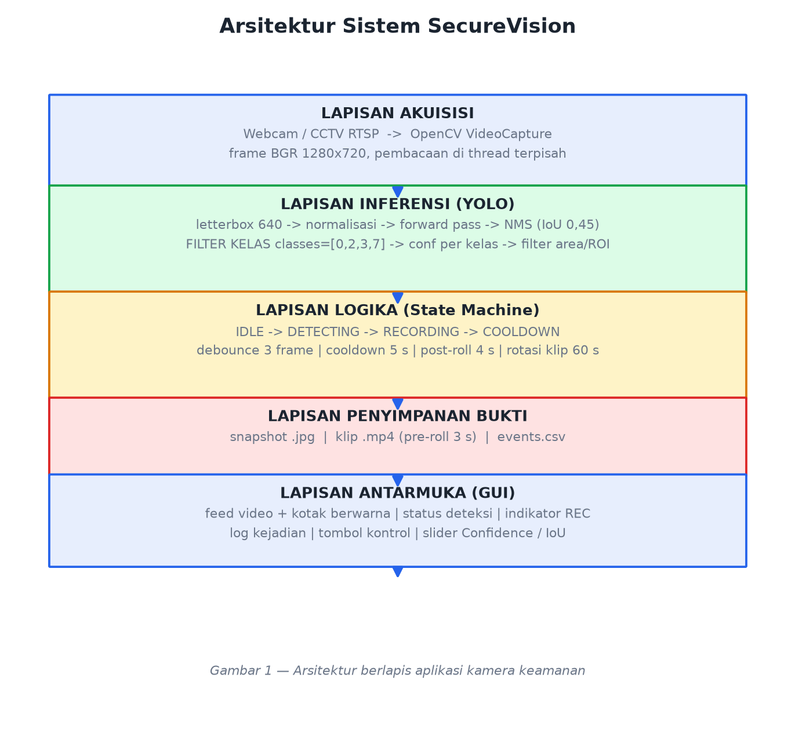

---

## 3. KONFIGURASI MODEL PRE-TRAINED

*Menjawab pertanyaan 1.*

### 3.1 Pemilihan Arsitektur

**Keputusan: YOLOv11-nano (`yolo11n.pt`), dengan *fallback* YOLOv8-nano.**

| Kriteria | YOLOv11n / YOLOv8n | Faster R-CNN (R50-FPN) | SSD-MobileNetV2 | EfficientDet-D0 |
|---|---|---|---|---|
| Jenis | *single-stage* | *two-stage* | *single-stage* | *single-stage* |
| Parameter | sekitar 2,6 juta | sekitar 41,5 juta | sekitar 4,3 juta | sekitar 3,9 juta |
| Komputasi | sekitar 6,5 GFLOPs | sekitar 180 GFLOPs | sekitar 1,2 GFLOPs | sekitar 2,5 GFLOPs |
| Kecepatan (GPU T4) | **8–12 ms/frame** | 140–200 ms | sekitar 25 ms | sekitar 30 ms |
| mAP@50:95 (COCO) | sekitar 39,5 | sekitar 40,2 | sekitar 22 | sekitar 33,8 |
| Kemudahan *deploy* | satu berkas 5 MB, ekspor ONNX | berat | sedang | sedang |

**Alasan pemilihan:**

1. **Kecepatan *real-time*.** 8–12 ms/frame setara 80–120 FPS, jauh di atas kebutuhan 25–30 FPS kamera, sehingga sisa komputasi dapat dipakai untuk anotasi, enkode video, dan pembaruan GUI.
2. **Akurasi sepadan.** Selisih mAP dengan Faster R-CNN kurang dari satu poin, namun sekitar lima belas kali lebih cepat. Pertukaran ini sangat menguntungkan untuk sistem pengawasan.
3. **Bobot tersedia dan ekosistem matang.** `YOLO("yolo11n.pt")` mengunduh bobot COCO secara otomatis dan API-nya mendukung argumen `classes=` yang menjadi kunci pembatasan kelas.
4. **Varian nano** sengaja dipilih agar demonstrasi tetap lancar pada laptop tanpa GPU. Bila tersedia GPU, cukup mengganti ke `yolo11s.pt`.

### 3.2 Konfigurasi Dasar

```python
WEIGHTS  = "yolo11n.pt"   # bobot pre-trained COCO
IMG_SIZE = 640            # letterbox 640 x 640
CONF     = 0.35           # ambang keyakinan global
IOU_NMS  = 0.45           # ambang IoU untuk Non-Maximum Suppression
DEVICE   = 0              # GPU; "cpu" bila tanpa GPU
```

`IMG_SIZE = 640` merupakan titik keseimbangan: cukup besar untuk mendeteksi orang berukuran sedang hingga jauh, namun tetap ringan. Untuk kamera yang memantau halaman luas dengan objek kecil, nilai dapat dinaikkan ke 960–1280; untuk laptop dengan kemampuan terbatas dapat diturunkan ke 416. `IOU_NMS = 0.45` adalah standar COCO; nilai terlalu kecil akan menghapus kotak sah pada objek yang berdekatan, sedangkan nilai terlalu besar menyisakan kotak ganda.

### 3.3 Strategi Pembatasan pada Empat Kelas Target

Pembatasan dilakukan bertingkat dalam tiga lapis, diurutkan dari yang paling hemat komputasi.

#### Lapis 1 — Filter di level model: `classes=[0, 2, 3, 7]`

```python
results = model.predict(
    frame,
    imgsz=640,
    conf=0.30,              # ambang terendah; disaring ulang pada lapis 2
    iou=0.45,               # Non-Maximum Suppression
    classes=[0, 2, 3, 7],   # person, car, motorcycle, truck
    device=0,
    verbose=False,
)
```

Argumen `classes=` pada Ultralytics membuang *logit* 76 kelas lain **sebelum NMS**. Dampaknya nyata: komputasi NMS menurun karena kandidat kotak jauh lebih sedikit, *false positive* dari kelas yang mirip seperti `bus`, `bicycle`, `dog`, `cat`, `chair`, dan `traffic light` tidak pernah muncul, serta tidak mungkin terjadi kebingungan antara kelas yang mirip.

> Penyaringan memang **boleh** dilakukan di level aplikasi dengan `if name in TARGETS`, tetapi itu hanya membuang hasil setelah seluruh komputasi selesai. Menyaring di level model adalah praktik yang benar karena menghemat waktu sekaligus mencegah kebingungan antar-kelas.

#### Lapis 2 — Ambang keyakinan per kelas

Tidak semua kelas pantas diperlakukan sama. Untuk sistem keamanan, **person** adalah kelas paling kritis sehingga dibuat paling sensitif.

```python
PER_CLASS_CONF = {
    "person":    0.30,   # paling sensitif (recall tinggi)
    "motorbike": 0.35,
    "car":       0.40,   # lebih ketat: menekan alarm palsu
    "truck":     0.40,
}
```

Model dipanggil dengan nilai ambang terendah di antara `PER_CLASS_CONF`, lalu setiap hasil disaring ulang berdasarkan ambang kelasnya masing-masing.

#### Lapis 3 — Filter spasial di level aplikasi

```python
min_area    = 900     # piksel persegi: buang kotak lebih kecil dari ~30 x 30 px
roi_polygon = []      # opsional: hanya area tertentu, misalnya polygon pintu masuk
```

Filter area mencegah objek yang sangat jauh memicu rekaman. Filter ROI berguna untuk mengabaikan jalan raya di luar pagar yang tampak di sudut kamera, yang merupakan sumber alarm palsu paling umum pada CCTV.

### 3.4 Konfigurasi *Fine-Tuning* (opsional)

Bila kamera memiliki karakteristik khusus seperti sudut pandang atas, kondisi malam, atau inframerah, dilakukan *fine-tuning* ringan dengan pengaturan berikut.

| Parameter | Nilai | Alasan |
|---|---|---|
| `pretrained` | `True` | Memulai dari bobot COCO |
| `freeze` | 10 | Membekukan 10 blok *backbone* awal agar cepat dan anti *overfitting* |
| `epochs` | 50 (uji cepat: 5) | Dengan *early stopping* `patience=10` |
| `batch` | 16 (T4) atau 8 (VRAM kecil) | Menyesuaikan memori |
| `imgsz` | 640 | Sama dengan saat inferensi |
| `optimizer` | `auto` (AdamW) | Konvergensi stabil |
| `cos_lr` | `True` | Penurunan *learning rate* kosinus |
| Augmentasi | `hsv_h`, `fliplr=0.5`, `scale=0.5`, `mosaic=1.0` | Tahan terhadap variasi cahaya dan sudut |

Dataset publik umumnya berlabel 80 kelas. Agar model **benar-benar hanya mengenal empat kelas**, label harus di-remap ke indeks 0 sampai 3 dan baris kelas lain dihapus dari berkas `.txt`. Fungsi `remap_dataset_to_targets()` pada notebook melakukan hal ini secara otomatis.

---

## 4. ALUR KERJA SISTEM

*Menjawab pertanyaan 2.*

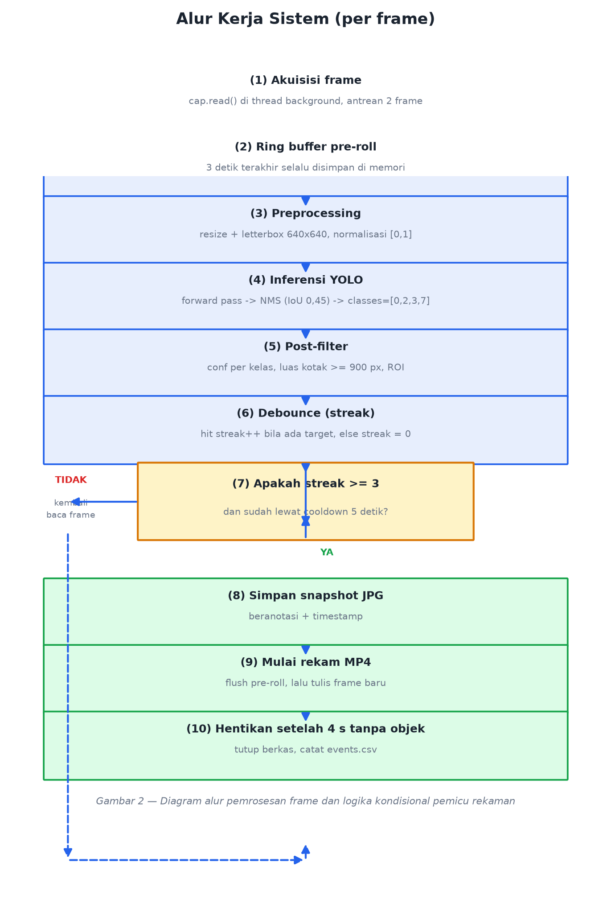

### 4.1 Penjelasan Tiap Tahap

| Tahap | Penjelasan teknis | Keluaran |
|---|---|---|
| 1. Akuisisi *frame* | `cv2.VideoCapture` dibaca pada *thread* terpisah agar GUI tidak tersendat. Antrean berkapasitas kecil membuat *frame* lama dibuang bila inferensi lambat, sehingga sistem selalu memproses keadaan terkini. | *frame* BGR 1280 x 720 |
| 2. Ring buffer (*pre-roll*) | Tiga detik terakhir terus disimpan di memori. Saat pemicu aktif, isi buffer ditulis lebih dulu ke berkas video sehingga rekaman menampilkan kejadian **sebelum** pemicu. Tanpa *pre-roll*, klip baru dimulai saat penyusup sudah berada di dalam area. | 60 *frame* |
| 3. *Preprocessing* | *Resize* dengan mempertahankan rasio aspek (*letterbox*) ke 640 x 640 lalu normalisasi ke rentang 0 sampai 1. *Letterbox* mencegah distorsi bentuk orang dan kendaraan. | tensor |
| 4. Inferensi | Satu *forward pass* menghasilkan ribuan kandidat kotak; NMS dengan ambang IoU 0,45 merampingkannya; `classes=[0,2,3,7]` membuang 76 kelas lain. | daftar kotak |
| 5. *Post-filter* | Ambang *confidence* per kelas, luas kotak minimum, dan opsional ROI. | deteksi valid |
| 6. *Debounce* | Penghitung *frame* berturut-turut yang berisi target. Deteksi satu *frame* diabaikan untuk menekan *false positive* akibat kedipan cahaya, artefak kompresi, atau bayangan sesaat. | nilai *streak* |
| 7. Logika kondisional | Inti sistem; rincian pada subbab 4.2. | aksi simpan atau rekam |
| 8. Anotasi dan HUD | Kotak berwarna per kelas, label kelas dan *confidence*, bilah status atas, serta titik merah berkedip saat merekam. | *frame* siap tayang |
| 9. Tampilan dan log | *Frame* dikonversi BGR ke RGB lalu ditampilkan; panel samping menampilkan jumlah per kelas, FPS, dan log kejadian terakhir. | GUI |

### 4.2 Rincian Logika Kondisional

```python
# --- Konstanta pemicu ---
MIN_CONSECUTIVE_FRAMES = 3     # debounce: harus tiga frame berturut-turut
COOLDOWN_SECONDS       = 5.0   # jeda antar dua event
PRE_ROLL_SECONDS       = 3.0   # rekam tiga detik SEBELUM pemicu
POST_ROLL_SECONDS      = 4.0   # berhenti empat detik SETELAH objek hilang
MAX_CLIP_SECONDS       = 60.0  # rotasi berkas
SNAPSHOT_COOLDOWN      = 2.0   # jeda antar snapshot

# --- Algoritma per frame ---
if not recording:
    ring_buffer.push(frame)                     # pre-roll
detections = detector.predict(frame)            # inferensi + filter
hit = len(detections) > 0
streak = streak + 1 if hit else 0
if hit:
    last_hit = now()

if recording:
    writer.write(annotated_frame)
    if now - start > MAX_CLIP_SECONDS:          # (a) rotasi berkas
        stop(); start()
    elif not hit and now - last_hit > POST_ROLL_SECONDS:
        stop(); last_stop = now()               # (b) objek hilang
else:
    if (streak >= MIN_CONSECUTIVE_FRAMES        # (c) syarat mulai
            and now - last_stop > COOLDOWN_SECONDS):
        save_jpg(annotated_frame)               # simpan gambar
        start_recording(pre_roll=ring_buffer)   # mulai rekam video
        log_event("REC_START", detections)
```

**Empat kondisi kunci beserta alasannya:**

| Kondisi | Tanpa pengaman | Dengan pengaman |
|---|---|---|
| *streak* minimal 3 | Bayangan daun yang melintas satu *frame* langsung memicu rekaman | Diabaikan karena harus muncul pada tiga *frame* berturut-turut |
| *cooldown* 5 detik | Orang berdiri sepuluh menit menghasilkan ratusan berkas | Satu *event*, lalu jeda; snapshot dibatasi dua detik per berkas |
| *post-roll* 4 detik | Objek tersembunyi setengah detik di balik tiang memecah rekaman menjadi banyak klip | Rekaman tetap satu klip utuh |
| *maksimum* 60 detik | Satu berkas video berukuran ratusan MB | Berkas dipecah per menit sehingga mudah dikelola |

### 4.3 Transisi *State*

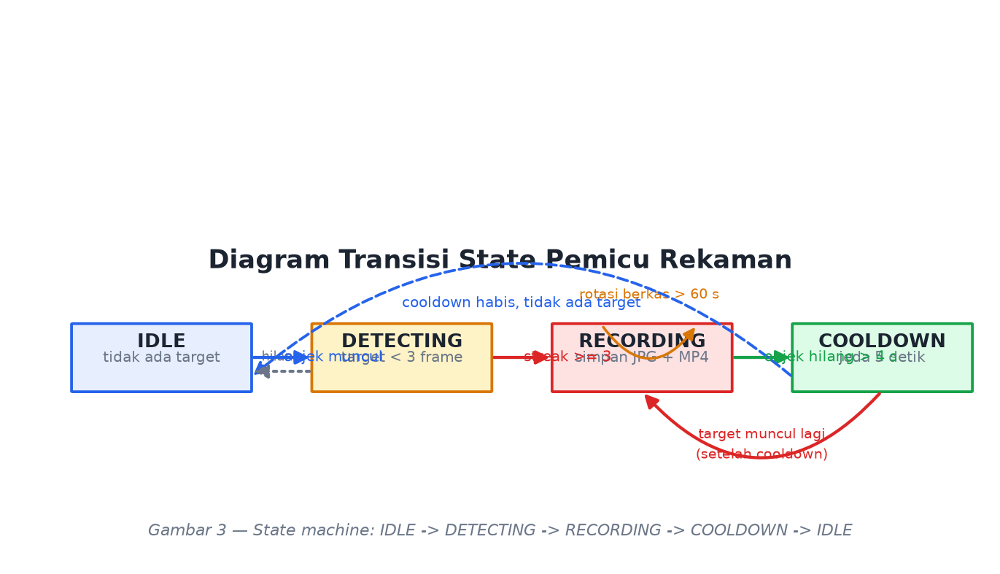

| *State* saat ini | Kondisi | *State* berikutnya | Aksi |
|---|---|---|---|
| IDLE | tidak ada target | IDLE | — |
| IDLE | target terdeteksi, *streak* kurang dari 3 | DETECTING | menampilkan peringatan kuning |
| DETECTING | *streak* mencapai 3 dan lewat *cooldown* | RECORDING | simpan JPEG dan mulai MP4 |
| RECORDING | target masih ada | RECORDING | terus menulis *frame* |
| RECORDING | target hilang lebih dari empat detik | COOLDOWN | tutup berkas dan catat ke CSV |
| RECORDING | durasi lebih dari 60 detik | RECORDING | rotasi ke berkas baru |
| COOLDOWN | target muncul lagi setelah lima detik | RECORDING | *event* baru |

### 4.4 Spesifikasi Keluaran

```
runs/camera_ui_baru/
├── recordings/
│   ├── rec_20250115_203412_0001.mp4   # klip: pre-roll + kejadian + post-roll
│   └── rec_20250115_203501_0002.mp4
├── snapshots/
│   ├── snap_20250115_203412.jpg
│   └── snap_20250115_203501.jpg
└── events.csv                          # timestamp,event,classes,n_objects,file
```

Setiap berkas diberi nama berdasarkan cap waktu sehingga mudah diurutkan dan dilacak. Anotasi digambar pada berkas yang disimpan agar barang bukti mudah diverifikasi manusia; tersedia opsi untuk menyimpan rekaman mentah tanpa anotasi bila diperlukan.

---

## 5. METRIK EVALUASI DETEKSI

*Menjawab pertanyaan 3.*

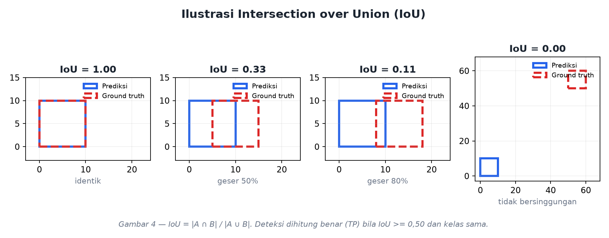

### 5.1 Intersection over Union (IoU)

IoU, atau *Jaccard Index*, mengukur tingkat tumpang-tindih antara kotak prediksi dan kotak *ground truth*.

$$\mathrm{IoU} = \frac{\text{area}(B_p \cap B_{gt})}{\text{area}(B_p \cup B_{gt})} = \frac{|B_p \cap B_{gt}|}{|B_p| + |B_{gt}| - |B_p \cap B_{gt}|}$$

| Nilai IoU | Interpretasi |
|---|---|
| 1,00 | kotak identik |
| 0,50 | tumpang-tindih cukup, ambang standar COCO |
| 0,33 | setengah bergeser |
| 0,00 | tidak bersinggungan sama sekali |

IoU dipakai pada dua tempat berbeda. Pertama, pada **NMS** untuk menghapus kotak ganda pada objek yang sama dengan ambang sekitar 0,45. Kedua, sebagai **penentu benar atau salah**: prediksi dihitung *True Positive* bila IoU bernilai minimal $t$ dan kelasnya sama, dengan $t = 0{,}50$ untuk mAP@0.50 dan $t = 0{,}50$ hingga $0{,}95$ untuk mAP COCO.

### 5.2 Confusion Matrix Deteksi Objek

| | Definisi | Analogi pada CCTV |
|---|---|---|
| **TP** (*True Positive*) | objek ada, terdeteksi, IoU memenuhi ambang, kelas benar | penyusup terdeteksi |
| **FP** (*False Positive*) | mendeteksi sesuatu yang tidak ada atau IoU di bawah ambang | alarm palsu, misalnya kucing atau bayangan |
| **FN** (*False Negative*) | objek ada tetapi **tidak terdeteksi** | **penyusup lolos** |
| TN | tidak ada objek dan tidak ada deteksi | tidak dihitung pada deteksi objek |

### 5.3 Precision dan Recall

$$\mathrm{Precision} = \frac{TP}{TP + FP} \qquad \mathrm{Recall} = \frac{TP}{TP + FN}$$

**Precision** menjawab pertanyaan: dari semua yang dinyatakan "ada orang", berapa yang benar-benar orang. **Recall** menjawab: dari semua orang yang benar-benar lewat, berapa yang berhasil ditangkap. Kedua metrik ini saling berlawanan; menurunkan ambang *confidence* menaikkan *recall* tetapi menurunkan *precision*, dan sebaliknya.

$$F_\beta = \frac{(1+\beta^2)\,P\,R}{\beta^2 P + R}$$

Untuk $\beta = 1$ diperoleh **F1** yang seimbang. Untuk $\beta = 2$ diperoleh **F2** yang memberi bobot empat kali lipat pada *recall*, sehingga lebih tepat untuk sistem keamanan.

### 5.4 Average Precision (AP) dan mean Average Precision (mAP)

Langkah perhitungan AP untuk satu kelas:

1. Urutkan seluruh prediksi berdasarkan *confidence* secara menurun.
2. Hitung TP dan FP kumulatif untuk memperoleh kurva Precision terhadap Recall.
3. **AP** adalah luas di bawah kurva tersebut.
4. **mAP** adalah rata-rata AP terhadap seluruh kelas.

$$\mathrm{AP} = \int_0^1 p(r)\,dr \approx \sum_{k} (r_{k+1} - r_k)\,p_{k+1}$$

$$\mathrm{mAP} = \frac{1}{K}\sum_{k=1}^{K} \mathrm{AP}_k$$

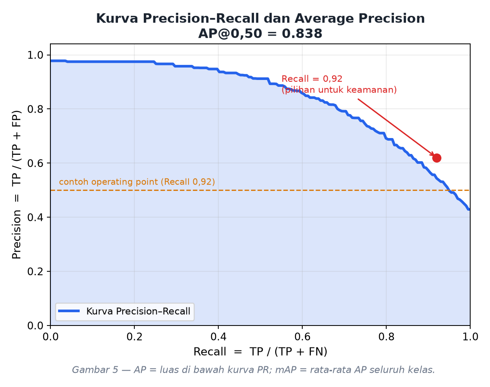

| Metrik | Ambang IoU | Makna |
|---|---|---|
| **mAP@0.50** | hanya 0,50 | Apakah objeknya ditemukan; longgar |
| **mAP@0.50:0.95** | rata-rata 0,50 sampai 0,95 | Metrik utama COCO; menuntut lokalisasi presisi |

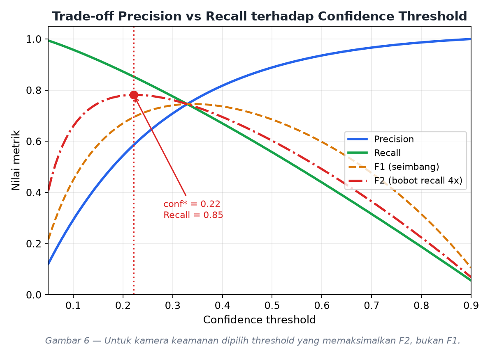

### 5.5 Contoh Perhitungan Numerik

Sebuah *frame* berisi **tiga orang** sebagai *ground truth*. Model menghasilkan **tiga prediksi**:

| Prediksi | Confidence | IoU dengan GT | Kelas | Status |
|---|---|---|---|---|
| A | 0,95 | 0,82 | person | TP karena IoU minimal 0,50 |
| B | 0,70 | 0,74 | person | TP |
| C | 0,40 | 0,00 (area kosong) | person | FP |
| — | — | — | GT ketiga tidak terdeteksi | FN |

$$TP = 2,\quad FP = 1,\quad FN = 1$$

$$\mathrm{Precision} = \frac{2}{2+1} = 0{,}667 \qquad \mathrm{Recall} = \frac{2}{2+1} = 0{,}667$$

$$\mathrm{AP@0.50} = 0{,}667 \qquad \mathrm{mAP@0.50:0.95} = 0{,}400$$

Angka tersebut dapat direproduksi dengan menjalankan `python -m src.core.metrics` atau sel 4.3 pada notebook.

### 5.6 Metrik Paling Krusial untuk Kamera Keamanan

> **Jawaban: RECALL**, yang diukur pada ambang IoU longgar (minimal 0,50) dan pada *operating point* atau ambang *confidence* yang benar-benar dipakai sistem saat berjalan.

**Argumen pertama: asimetri biaya kesalahan.**

| Kondisi | Metrik yang turun | Akibat | Biaya |
|---|---|---|---|
| Penyusup tidak terdeteksi | **Recall turun** | pencurian terjadi dan **tidak ada rekaman sama sekali** | Fatal dan permanen |
| Alarm palsu | Precision turun | petugas mengecek CCTV beberapa detik | Mengganggu namun murah |

Karena $\mathrm{Recall} = TP / (TP + FN)$, metrik ini merupakan satu-satunya metrik yang berbanding terbalik secara langsung dengan jumlah penyusup yang lolos. Bila recall bernilai 0,90, artinya satu dari sepuluh penyusup lolos tanpa meninggalkan jejak.

**Argumen kedua: mengapa bukan mAP.** mAP adalah rata-rata AP terhadap seluruh nilai *confidence* dan seluruh ambang IoU 0,50 sampai 0,95, padahal sistem nyata hanya berjalan pada satu nilai *confidence*. Akibatnya, model dengan mAP@50:95 sebesar 0,85 dapat saja memiliki recall hanya 0,60 pada ambang yang dipakai aplikasi, yang berarti empat puluh persen penyusup lolos. mAP juga mencampur kelas `car` dan `truck` yang berisiko rendah bersama `person` yang berisiko tinggi, sehingga menutupi kelemahan pada kelas terpenting. Karena itu **mAP dipakai untuk memilih model pada fase pengembangan, bukan untuk menyetel sistem yang sedang berjalan.**

**Argumen ketiga: mengapa bukan Precision.** Precision rendah menimbulkan *alarm fatigue*, yaitu kondisi di mana petugas mulai mengabaikan alarm. Hal ini memang berbahaya, tetapi dampaknya bertahap dan dapat diperbaiki. Sebaliknya, recall rendah berakibat hilangnya barang bukti secara permanen.

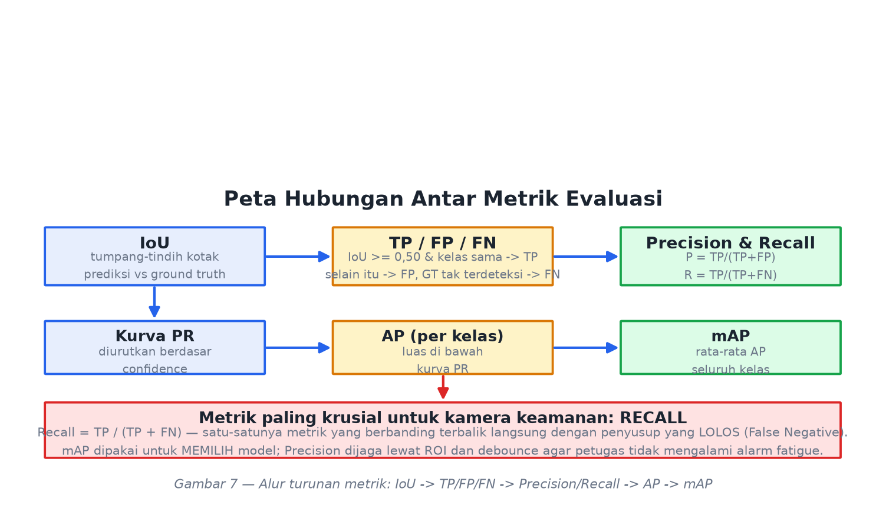

**Strategi optimasi recall yang konkret:**

| Langkah | Efek | Risiko yang dikendalikan |
|---|---|---|
| Turunkan ambang *confidence* kelas `person` ke 0,25–0,30 | recall naik | precision turun, dijaga oleh *debounce* dan ROI |
| Terapkan *threshold* berbeda per kelas | recall `person` naik tanpa mengorbankan `car` dan `truck` | — |
| Longgarkan IoU NMS dari 0,45 ke 0,60 | objek berhimpitan tidak saling menghapus | kotak ganda sedikit meningkat |
| Gunakan **F2-score**, bukan F1, saat memilih *threshold* | keputusan condong ke recall | — |
| Turunkan luas kotak minimum | recall jarak jauh naik | noise naik, dijaga oleh *debounce* |
| Tambah data malam hari dan oklusi lalu *fine-tune* | recall naik tanpa menurunkan precision | — |
| Tetapkan target terukur, misalnya Recall minimal 0,95 dengan Precision minimal 0,70 | dapat diaudit | — |

> **Ringkasan satu kalimat.** mAP dipakai untuk memilih model, Precision dijaga agar petugas tidak mengalami *alarm fatigue*, tetapi **Recall adalah metrik yang paling krusial** karena merupakan satu-satunya metrik yang mengukur penyusup yang lolos.

---

## 6. PERANCANGAN ANTARMUKA PENGGUNA

*Menjawab pertanyaan 4.*

### 6.1 Prinsip Perancangan

| Prinsip | Penerapan |
|---|---|
| Tema terang (*light theme*) | Latar `#F4F6FA`, kartu putih, teks gelap `#1B2430` |
| Hirarki visual jelas | *Feed* video menempati sekitar tujuh puluh persen lebar; panel status di kanan; kontrol di bawah |
| Sinyal status universal | Hijau berarti aman, kuning berarti waspada, merah berkedip berarti merekam |
| Umpan balik langsung | Setiap *event* langsung muncul pada log; indikator REC berkedip 2 Hz |
| Konsistensi warna kelas | Warna kotak pada video sama dengan warna *chip* pada panel kanan |

### 6.2 Palet Warna

| Peran | Kode | Penggunaan |
|---|---|---|
| Latar aplikasi | `#F4F6FA` | latar jendela |
| Kartu atau panel | `#FFFFFF` | panel status dan log |
| Batas | `#DCE1EA` | garis pemisah halus |
| Teks utama | `#1B2430` | label dan judul |
| Teks sekunder | `#6B7688` | keterangan |
| Aksen primer | `#2563EB` | tombol utama |
| Sukses | `#16A34A` | status aman |
| Peringatan | `#D97706` | status mendeteksi |
| Bahaya | `#DC2626` | status merekam |
| Kelas person | `#20A840` | kotak dan *chip* |
| Kelas car | `#1A76E8` | kotak dan *chip* |
| Kelas truck | `#D63636` | kotak dan *chip* |
| Kelas motorbike | `#E05C18` | kotak dan *chip* |

### 6.3 Rancangan Antarmuka (*Mockup*)

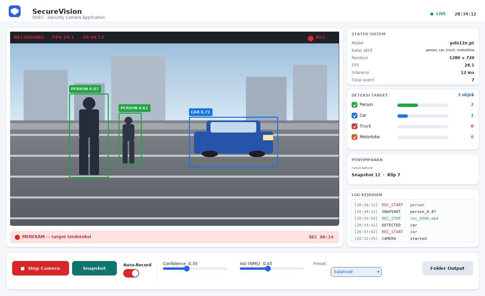

Komponen pada mockup tersebut:

| Area | Komponen | Fungsi |
|---|---|---|
| A. Bilah atas | Judul, badge LIVE, jam digital | Identitas aplikasi dan status kamera |
| B. *Feed* video | Kanvas video, HUD, titik REC berkedip, timer | Menampilkan *frame*, kotak deteksi, dan indikator perekaman |
| C. Panel status | Status sistem, deteksi per kelas, penyimpanan, log | Informasi operasional secara ringkas |
| D. Baris kontrol | Start/Stop, Snapshot, Auto-Record, *slider*, *preset* | Kendali aplikasi |

### 6.4 Spesifikasi Komponen

| Komponen | Fungsi |
|---|---|
| Kanvas video | Menampilkan *frame* beserta kotak berwarna, label kelas, *confidence*, dan HUD |
| Titik merah berkedip dan teks REC | Indikator bahwa perekaman otomatis sedang berjalan |
| Bilah status | Teks AMAN, MENDETEKSI, MEREKAM, atau COOLDOWN disertai warna |
| Timer REC | Durasi rekaman yang sedang berjalan |
| Kartu status sistem | Model, kelas aktif, resolusi, FPS, waktu inferensi, jumlah *event* |
| Kartu deteksi target | *Checkbox*, *progress bar*, dan jumlah objek per kelas |
| Kartu penyimpanan | Lokasi folder, jumlah snapshot dan klip |
| Kotak log kejadian | Dua belas kejadian terakhir berstempel waktu |
| Tombol Start/Stop | Memulai atau menghentikan akuisisi kamera |
| Tombol Snapshot | Menyimpan gambar secara manual |
| *Switch* Auto-Record | Mengaktifkan atau menonaktifkan perekaman otomatis |
| *Slider* Confidence dan IoU | Mengubah ambang secara langsung tanpa menghentikan kamera |
| *Dropdown* Preset | Pilihan balanced, max_recall, low_false_alarm, fast |
| Tombol Folder Output | Membuka lokasi penyimpanan bukti |

### 6.5 Alur Interaksi Pengguna

1. Aplikasi dibuka dan berstatus OFFLINE dengan tombol Start Camera menyala biru.
2. Setelah Start ditekan, model dimuat dan kamera dibuka sehingga badge berubah menjadi LIVE.
3. Saat tidak ada target, bilah status berwarna hijau dengan teks AMAN.
4. Saat target muncul pada tiga *frame* berturut-turut, bilah berubah merah, titik REC berkedip, berkas JPEG tersimpan, dan entri log bertambah.
5. Saat target hilang selama empat detik, status berubah menjadi COOLDOWN dan berkas MP4 ditutup.
6. Pengguna dapat menyesuaikan Confidence dan IoU secara langsung, memilih preset `max_recall` bila membutuhkan pengawasan maksimal, atau membuka folder bukti.

---

## 7. HASIL IMPLEMENTASI DAN UJI COBA

### 7.1 Struktur Proyek

```
DSEC_ets_object_detection/
├── camera_ui_baru/              aplikasi kamera mandiri yang DIDEMOKAN
│   ├── app.py                   antarmuka Tkinter
│   ├── camera.py                pembaca kamera pada thread background
│   ├── detector.py              filter empat kelas target
│   └── recorder.py              pemicu snapshot dan rekaman otomatis
├── DSEC_Security_Camera_ETS.ipynb   notebook Google Colab
├── docs/
│   ├── LAPORAN_Soal2.md / .html / .pdf
│   └── gambar/                  seluruh ilustrasi laporan ini
├── src/                         implementasi modular dengan GUI light theme
│   ├── app.py  headless.py
│   └── core/  config  detector  recorder  pipeline  metrics  camera
├── tests/test_pipeline.py       sembilan belas pengujian logika
└── tools/                       pembangkit notebook, mockup, figur, dan PDF
```

### 7.2 Cara Menjalankan

```bash
# --- aplikasi kamera mandiri (yang didemokan) ---
python -m camera_ui_baru.app
python -m camera_ui_baru.app --source 1
python -m camera_ui_baru.app --backend dshow          # Windows DirectShow
python -m camera_ui_baru.app --weights best.pt

# --- aplikasi modular dengan GUI light theme ---
python -m src.app

# --- tanpa GUI ---
python -m src.headless --source 0

# --- diagnostik kamera ---
python -m src.core.camera --max-index 3 --timeout 3

# --- pengujian logika ---
python -m tests.test_pipeline
```

### 7.3 Hasil Deteksi pada Empat Kelas Target

Keempat tangkapan layar berikut diambil langsung dari aplikasi yang berjalan pada komputer penulis. Setiap tangkapan memperlihatkan kotak deteksi beserta label kelas dan nilai *confidence* yang ditampilkan secara *real-time*.

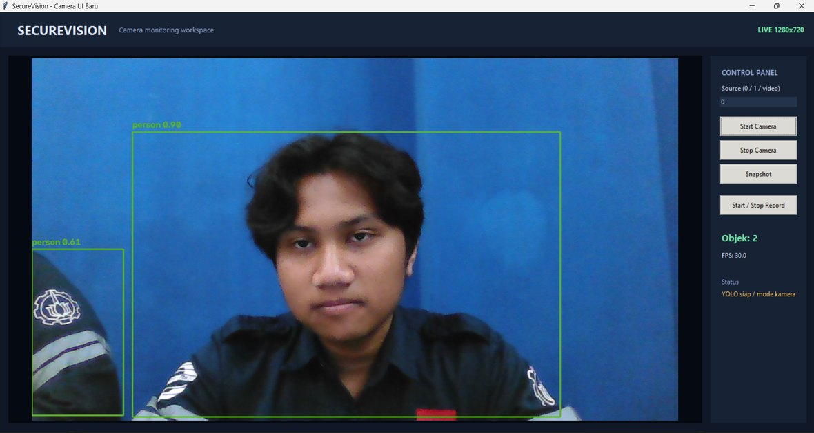

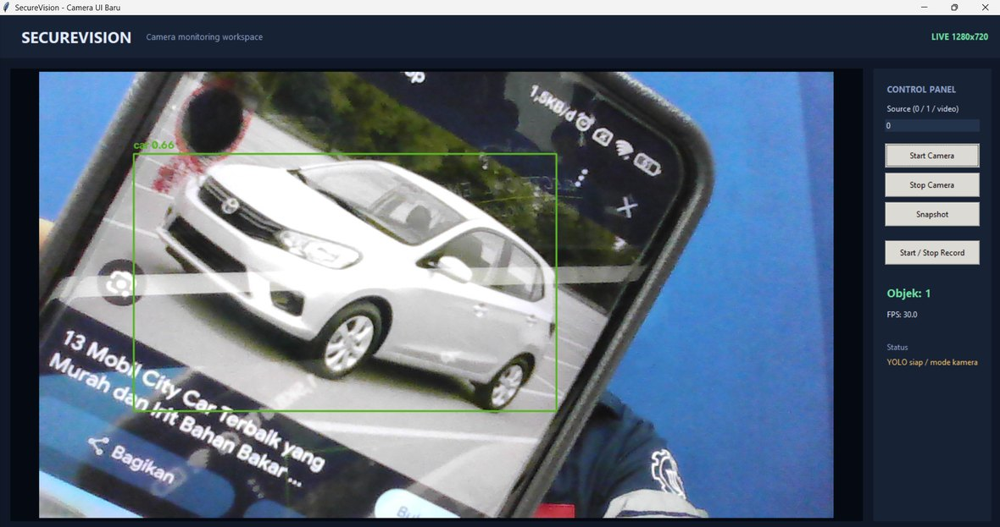

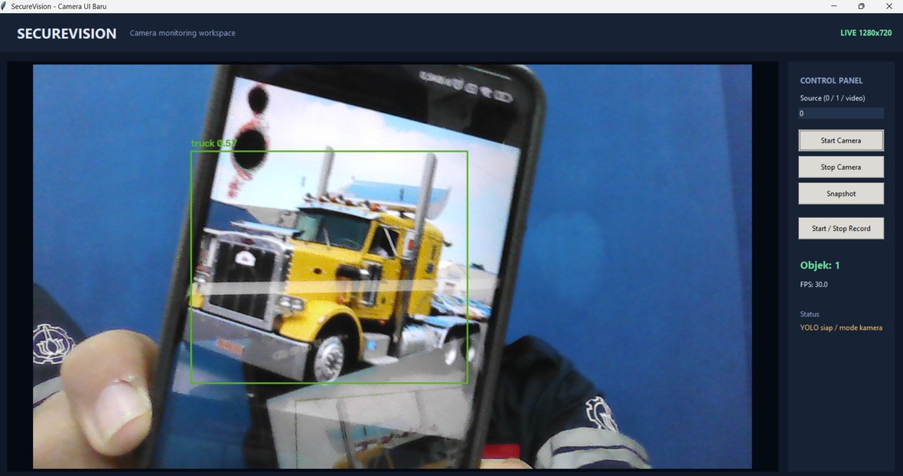

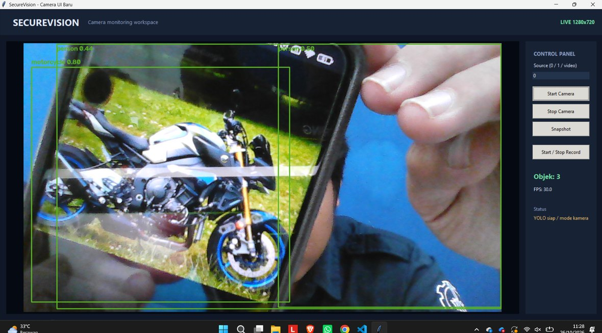

Keempat gambar tersebut membuktikan bahwa keempat kelas target yang diminta soal, yaitu `person`, `car`, `truck`, dan `motorbike`, berhasil dideteksi oleh model *pre-trained* yang digunakan.

### 7.4 Hasil Pengujian Logika

Pengujian dilakukan tanpa model dan tanpa kamera menggunakan `MockDetector`, sehingga *state machine* dan mekanisme penyimpanan dapat diverifikasi di mesin mana pun.

```
============================================================
   SELF-TEST SECUREVISION (tanpa model, tanpa kamera)
============================================================
[1] State machine IDLE -> DETECTING -> RECORDING -> COOLDOWN
    tanpa objek -> IDLE                                 OK
    objek konsisten -> RECORDING                        OK
    objek hilang -> berhenti merekam                    OK
    klip video tersimpan                                OK
    snapshot tersimpan                                  OK
    log CSV terisi                                      OK
    klip berisi frame (pre-roll masuk)      21 frame    OK
[2] Debounce: flicker 1 frame tidak memicu rekaman      OK
[3] Pemetaan kelas -> COCO ids [0,2,3,7]                OK
[4] IoU 1.000 / 0.333 / 0.000                           OK
[5] Precision 0.667, Recall 0.667, TP=2 FP=1 FN=1       OK
[6] Rotasi klip saat durasi maksimum       3 klip       OK
============================================================
   HASIL: 19 lulus, 0 gagal
============================================================
```

Tiga hal yang terbukti dari pengujian tersebut. Pertama, **pre-roll bekerja**: klip berisi 21 *frame* padahal objek baru muncul pada *frame* ke-16, yang berarti lima sampai enam *frame* sebelum pemicu ikut tersimpan. Kedua, **debounce bekerja**: deteksi satu *frame* tidak menghasilkan berkas apa pun. Ketiga, **rotasi berkas bekerja**: durasi 60 detik yang dipaksa menjadi 0,3 detik menghasilkan tiga klip terpisah, bukan satu klip raksasa.

### 7.5 Evaluasi Kuantitatif di Google Colab

Notebook `DSEC_Security_Camera_ETS.ipynb` menyediakan sel untuk menghitung metrik secara otomatis, baik memakai `model.val()` dari Ultralytics maupun implementasi mandiri IoU, Precision, Recall, AP, dan mAP yang ditulis dari nol. Notebook juga menyediakan *threshold sweep* untuk mencari ambang *confidence* terbaik berdasarkan F2-score. Nilai metrik yang diperoleh dapat langsung disalin ke tabel berikut.

| Metrik | Nilai | Cara memperoleh |
|---|---|---|
| Precision | isi dari sel 4.1 | `metrics.results_dict['metrics/precision(B)']` |
| Recall | isi dari sel 4.1 | `metrics.results_dict['metrics/recall(B)']` |
| mAP@0.50 | isi dari sel 4.1 | `metrics.results_dict['metrics/mAP50(B)']` |
| mAP@0.50:0.95 | isi dari sel 4.1 | `metrics.results_dict['metrics/mAP50-95(B)']` |
| mAP hitung manual | isi dari sel 4.4 | `compute_map_manual()` |
| Ambang *confidence* terbaik (F2) | isi dari sel 4.5 | *threshold sweep* |

---

## 8. PEMBAHASAN, KETERBATASAN, DAN PENGEMBANGAN

### 8.1 Keterbatasan

| Keterbatasan | Dampak | Mitigasi |
|---|---|---|
| Deteksi berbasis penampakan visual | Sulit pada malam hari tanpa inframerah, kabut, atau hujan deras | Kamera inframerah atau peningkatan kecerahan lokal sebelum inferensi |
| Objek sangat kecil | Recall menurun | Naikkan `IMG_SIZE` menjadi 960–1280 |
| Oklusi berat | Objek tertutup tidak terdeteksi | Pelacakan objek dan *post-roll* yang lebih panjang |
| Kamera tanpa GPU | Sekitar 3–6 FPS | `IMG_SIZE=416`, *frame skip*, atau ekspor ONNX |
| Tidak mengenali identitas | Hanya mengetahui bahwa ada orang | Tambahkan ReID atau pengenalan wajah sebagai tahap lanjut |

### 8.2 Usulan Pengembangan

1. **Pelacakan multi-objek** untuk mengenali bahwa orang pada *frame* pertama dan kedua adalah objek yang sama, sehingga dapat dihitung durasi keberadaan dan arah gerak.
2. **Zona dan garis maya** berbentuk poligon, termasuk deteksi "garis terlewati" untuk mengetahui arah masuk dan keluar.
3. **Notifikasi *real-time*** melalui Telegram atau email yang menyertakan *thumbnail* saat *event* terjadi.
4. **Penyimpanan cerdas** dengan penghapusan otomatis klip tanpa *event* setelah beberapa hari dan kompresi H.265.
5. **Dasbor analitik** berisi grafik jumlah *event* per jam dan peta panas posisi deteksi.
6. **Optimasi perangkat *edge*** dengan ekspor ONNX ke TensorRT sehingga dapat berjalan 30 FPS pada Jetson Nano.

### 8.3 Pertimbangan Etis

Sistem pengawasan memproses data pribadi. Beberapa hal yang perlu diperhatikan antara lain pemasangan penanda area yang jelas, enkripsi dan pembatasan retensi rekaman, pengendalian akses terhadap log, serta kepatuhan pada regulasi perlindungan data yang berlaku. Rekaman hendaknya digunakan semata-mata untuk tujuan keamanan yang sah.

---

## 9. PENUTUP

### 9.1 Kesimpulan

1. **Arsitektur.** YOLOv11-nano dipilih sebagai *single-stage detector* dengan latensi 8–12 ms per *frame*. Pembatasan pada empat kelas dilakukan bertingkat: `classes=[0,2,3,7]` di level model, ambang *confidence* per kelas, serta filter luas kotak dan ROI di level aplikasi.
2. **Alur kerja.** Pengambilan *frame*, *ring buffer* untuk *pre-roll*, *letterbox* 640, *forward pass*, NMS, penyaringan kelas dan *confidence*, *debounce* tiga *frame*, lalu logika kondisional yang menyimpan JPEG dan memulai MP4, menghentikan rekaman empat detik setelah objek hilang, mencatat ke `events.csv`, serta merotasi berkas setiap 60 detik.
3. **Metrik.** IoU menentukan TP dan FP; Precision adalah $TP/(TP+FP)$; Recall adalah $TP/(TP+FN)$; AP adalah luas kurva Precision–Recall; mAP adalah rata-rata AP seluruh kelas. **Metrik paling krusial adalah Recall** karena berbanding terbalik langsung dengan jumlah penyusup yang lolos.
4. **Antarmuka.** Tema terang dengan empat area: bilah atas, *feed* video beserta indikator REC, panel status dan log, serta baris kontrol.

### 9.2 Saran

Untuk pengembangan selanjutnya, disarankan menambahkan pelacakan objek, zona deteksi berbentuk poligon, serta notifikasi *real-time* agar sistem tidak hanya merekam tetapi juga memberikan peringatan aktif kepada petugas keamanan.

---

## 10. DAFTAR PUSTAKA

1. Redmon, J., Divvala, S., Girshick, R., Farhadi, A. 2016. *You Only Look Once: Unified, Real-Time Object Detection*. CVPR 2016.
2. Ultralytics. 2024. *Ultralytics YOLO11 Documentation*. docs.ultralytics.com/models/yolo11.
3. Lin, T.-Y. et al. 2014. *Microsoft COCO: Common Objects in Context*. ECCV 2014.
4. Everingham, M. et al. 2010. *The PASCAL Visual Object Classes (VOC) Challenge*. IJCV 88(2).
5. Ren, S., He, K., Girshick, R., Sun, J. 2015. *Faster R-CNN: Towards Real-Time Object Detection with Region Proposal Networks*. NeurIPS 2015.
6. Zhang, Y. et al. 2022. *ByteTrack: Multi-Object Tracking by Associating Every Detection Box*. ECCV 2022.
7. Padilla, R., Netto, S. L., Da Silva, E. A. B. 2020. *A Survey on Performance Metrics for Object-Detection Algorithms*. IJCNN 2020.
8. Bradski, G. 2000. *The OpenCV Library*. Dr. Dobb's Journal.
9. Ultralytics. 2024. *Predict Mode — argument `classes`*. docs.ultralytics.com/modes/predict.

---

## 11. LAMPIRAN

### 11.1 Potongan Kode Inti

**Inisialisasi model dengan filter empat kelas**

```python
preds = self.model.predict(
    frame,
    imgsz=640,
    conf=0.30,            # ambang terendah; disaring ulang per kelas
    iou=0.45,             # ambang IoU untuk NMS
    classes=[0, 2, 3, 7], # person, car, motorcycle, truck
    verbose=False,
)
```

**Pemicu rekaman otomatis**

```python
enough_streak = streak >= 3
cooled_down   = (now - last_stop) >= 5.0

if enough_streak and cooled_down and not recording:
    recorder.start(pre_roll=ring_buffer.snapshot())   # pre-roll
    snapper.save(annotated_frame)                     # simpan JPG
    logger.log("REC_START", detections)
```

**Implementasi IoU**

```python
def iou(box_a, box_b):
    ax1, ay1, ax2, ay2 = box_a
    bx1, by1, bx2, by2 = box_b
    ix1, iy1 = max(ax1, bx1), max(ay1, by1)
    ix2, iy2 = min(ax2, bx2), min(ay2, by2)
    inter = max(0, ix2 - ix1) * max(0, iy2 - iy1)
    area_a = max(0, ax2 - ax1) * max(0, ay2 - ay1)
    area_b = max(0, bx2 - bx1) * max(0, by2 - by1)
    union = area_a + area_b - inter
    return inter / union if union > 0 else 0.0
```

### 11.2 Contoh Isi `events.csv`

```csv
timestamp,event,classes,n_objects,file
2025-01-15 20:34:12,DETECTED,person,1,
2025-01-15 20:34:12,REC_START,person,1,rec_20250115_203412_0001.mp4
2025-01-15 20:34:12,SNAPSHOT,person,1,snap_20250115_203412.jpg
2025-01-15 20:34:29,REC_STOP,person,340,rec_20250115_203412_0001.mp4
```

### 11.3 Tautan Pendukung

| Artefak | Lokasi |
|---|---|
| Notebook Google Colab | `DSEC_Security_Camera_ETS.ipynb` |
| Tombol Open in Colab | tersedia pada `README.md` repositori |
| Aplikasi kamera mandiri | `camera_ui_baru/` |
| Aplikasi modular | `src/` |
| Pengujian logika | `tests/test_pipeline.py` |
| Berkas laporan ini | `docs/LAPORAN_Soal2.pdf` |
